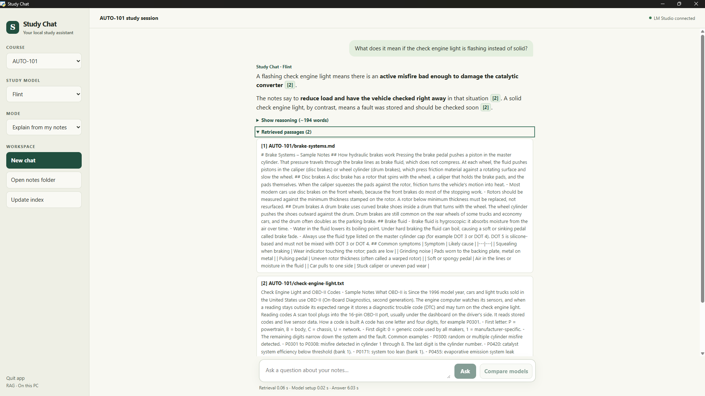

# Spectre Studio

**A local document search and Q&A app.** Drop your notes and PDFs into a folder, ask a question in plain English, and Spectre Studio finds the passages that answer it and shows you exactly where they came from: the file name and, for PDFs, the page number. Everything runs on your own computer. Your documents never leave it.

I built it because hunting through a semester's worth of PDFs for one formula or definition was slow. Spectre Studio turns that into a few seconds.



## What it does

- **Searches your own documents.** Reads PDF, TXT and Markdown files, splits them into passages, and finds the ones that match your question by meaning, not only by keywords.
- **Cites every source.** Each answer lists the passages it used, and you can expand them to read the original text. If your notes don't cover the question, it says so instead of guessing.
- **Reads text inside images.** Many lecture PDFs have formulas embedded as pictures. Spectre Studio runs OCR on those images and tags the results with their PDF page, so they're searchable too.
- **Organizes by course and library.** One folder per class, and libraries that group classes. Search one course or a whole library. If a file name in your question fits more than one file, Spectre Studio asks which one you mean.
- **Two modes:**
  - **Explain** (default): answers questions using only what's in your documents.
  - **Solve**: walks through a worked solution step by step, using the methods and formulas from your notes, then shows how to check the answer on a TI-84. The math comes from built-in calculation tools rather than the language model, so the numbers are reliable.
- **Fast updates.** Spectre Studio fingerprints each file and only processes notes that are new or changed, so updating the index after adding one PDF takes seconds instead of minutes.
- **Formatted math.** LaTeX formulas in answers are drawn with [KaTeX](https://katex.org) 0.19.1 (MIT license), which is included in `vendor/katex`, so nothing loads from the internet.
- **Bundled icons.** The interface uses [Lucide](https://lucide.dev) 1.79.0 icons (ISC license, see `vendor/lucide`), built into the page.
- **Dashboard.** The app opens on a dashboard where you pick a library and go straight to asking or solving. It shows whether LM Studio, the notes index and OCR are ready, when the index was last checked, and how much memory each GPU is using.
- **Model picker with live status.** Choose which local model writes the answers. Qwen 27B (`qwen/qwen3.8-27b`) is the default. The sidebar shows whether the model is loaded, loading or not loaded, as LM Studio reports it, including when you load or unload it there.
- **Indexing progress.** While the index updates, one percentage covers both reading pages and embedding passages. You also see which file and page it's on, or how many passages are done.
- **100% offline.** No API keys, no accounts, no cloud services.

## How it works

Spectre Studio is a **retrieval-augmented generation (RAG)** app:

1. **Ingest** (`ingest.py`): reads every file in `notes/<course>/`, extracts the text (plus OCR text from PDF images via Tesseract), and splits it into passages tagged with course, file and page.
2. **Embed and store:** each passage is turned into a vector with the Nomic Embed v1.5 model, running on an NVIDIA GPU through PyTorch CUDA, and saved in a local ChromaDB database.
3. **Update incrementally:** each PDF is fingerprinted (SHA-256), so unchanged files reuse their cached text and OCR. Only new or changed passages are embedded, and passages from deleted files are removed. The database is labeled with the embedding model that built it, so switching models triggers a full rebuild instead of mixing incompatible vectors. An update with no changes takes seconds.
4. **Retrieve (hybrid search):** passages from the selected course or library, or only the file your question names, are ranked by meaning (your question is embedded the same way and compared in ChromaDB) and by exact words (BM25 keyword search), then merged with weighted reciprocal rank fusion. The part of the question that asks for something counts most, so the story in a word problem doesn't crowd out the method. When a typed note and an OCR passage match about equally, the typed note comes first. The keyword ranking is built from the stored passages at question time, so it always matches the current index.
5. **Answer:** the passages go to a language model running in LM Studio, which writes an answer that cites them as [1], [2] and so on.
6. **Interface** (`study_chat.py`, `study_chat.html`, `study_app.pyw`): a small local web server and HTML interface, opened in its own desktop window with pywebview.

## Tech stack

Python 3.12 · ChromaDB · sentence-transformers (Nomic Embed v1.5) · PyTorch with CUDA · LM Studio local server · Tesseract OCR · pypdf · pywebview

**Tested on:** Windows 11 with a Radeon RX 7900 XT for the chat model and an RTX 3060, which runs the embedding model and also holds part of the chat model when LM Studio splits it across both GPUs.

## Benchmarks

User-measured on my PC (RTX 3060 + RX 7900 XT, LM Studio Vulkan), using a Solve-mode question asking for a 95% confidence interval for a proportion (n=120, x=54):

| Model | Answer time | Notes |
| --- | --- | --- |
| Qwen3.8 27B | ~35-41 s | Correct; cited the typed formula note; numbers from tools |
| GPT-OSS 20B | ~15-20 s | Correct interval; before the tool showed the standard error, it made one up |
| Flint | ~490 s | Correct, but about 7,000 words of reasoning |

With Qwen split across both GPUs, generation ran at about 42 tokens/s (about 35 s total answer time). On the 7900 XT alone, it ran at about 25 tokens/s (about 63 s). Answer time also depends on how long the model reasons.

## Setup

**You'll need:** Windows, Python 3.12, an NVIDIA GPU (recommended for speed), [LM Studio](https://lmstudio.ai/) with at least one chat model downloaded (the default is Qwen 27B, `qwen/qwen3.8-27b`), and optionally [Tesseract OCR](https://github.com/UB-Mannheim/tesseract/wiki) for reading text in PDF images.

1. Clone the repo and open a terminal in its folder:
   ```
   git clone https://github.com/JJSpectre/spectre-studio.git
   cd spectre-studio
   ```
2. Create a virtual environment and install the packages. Install PyTorch first, with CUDA support:
   ```
   python -m venv .venv
   .venv\Scripts\activate
   pip install torch==2.11.0 --index-url https://download.pytorch.org/whl/cu128
   pip install -r requirements.txt
   ```
3. Add your documents, one folder per course. To try it first, copy the `AUTO-101` folder from `sample-notes` into a new `notes` folder. It has two short sample notes on brakes and check engine codes, plus starter questions.
   ```
   notes\
       COURSE-1\
           chapter-1.pdf
           my-notes.txt
       COURSE-2\
           ...
   ```
4. In LM Studio, load a chat model and turn on the **Local Server** (port 1234).
5. Double-click **Setup Spectre Studio.cmd** once. It creates a **Spectre Studio** shortcut on your desktop.
6. Open Spectre Studio from the shortcut, go to the **Knowledge Libraries** page and click **Update index** to build the search database.

## Libraries

A library groups courses so you can search them together. On the **Knowledge Libraries** page, click **Create library**, give it a name, a category and an optional description, and tick the indexed courses that belong to it. On a library's card, the pencil edits it and the **⋮** button deletes it. You can search, sort and filter the list, and show it as a grid or a list. A library can start empty, but it can't be searched until it has an indexed course.

Libraries are saved in `libraries.toml`, which you can also edit by hand. To start that way, copy `libraries.sample.toml` and name the copy `libraries.toml`. Each library is one `[[library]]` section:

```toml
[[library]]
id = "automotive"
name = "Automotive"
category = "Engineering & Trades"
description = "Brakes, check engine codes and other shop notes."
courses = ["AUTO-101"]
```

The `id` is permanent (lowercase letters, digits and hyphens). Libraries made in the app get one automatically. The `name` can change at any time. The `category` and `description` (one line, up to 160 characters) are optional. The app's own categories have their own icon and color, and any other category gets a tag. After a hand edit, reopen Spectre Studio or click **Update index** to see your changes.

- Grouping never moves notes or re-indexes anything. Deleting a library only removes the grouping.
- Saving in the app rewrites `libraries.toml` and removes any comments in it. The app asks before it does that. `libraries.toml.bak` holds only the version from just before the last save, so the next save replaces it. If the file changed since the page loaded it, or has a mistake in it, the app won't save over it.
- Courses in no library appear under **Unsorted**, where you search them one at a time.
- `libraries.toml` and its backup stay out of Git, so your course names stay private.

## Starter questions

Each course can have its own starter cards on the welcome screen. Put a file named `starters.toml` in the course folder, with one `[[card]]` section per card:

```toml
[[card]]
title = "Review a concept"
detail = "How disc brakes work"
question = "How does a disc brake slow a wheel?"
```

Reopen Spectre Studio or click **Update index** to see your changes. Courses without this file show no cards. Everything under `notes` stays out of Git, so your own cards stay private.

## Notes on accuracy

- OCR can misread math symbols. For formulas you rely on, keep a typed version in a `.txt` file in the course folder. Spectre Studio prefers typed text over OCR when both exist.
- Answers are only as good as the documents behind them. Use the source passages to check anything important against the original.

## How this was built

I designed Spectre Studio, tested it on my own hardware, and directed every change, working with AI coding assistants to write and review much of the code. I'm studying Computer Science (AI-Assisted Software Engineering) at UNC Charlotte, and this project is how I learned RAG, embeddings, vector databases and local LLM tooling hands-on.
